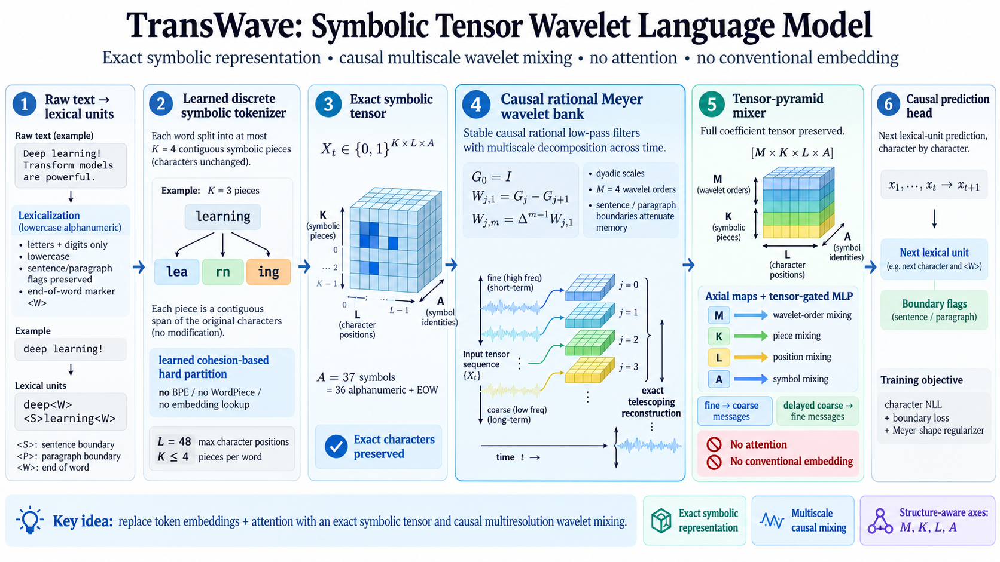

# TransWave V2

**A symbolic tensor wavelet language model with learned TPU-native tokenization, causal multiresolution processing, and infinite-support memory.**

TransWave V2 asks a deliberately different question from conventional language models:

> **What if language modelling starts from exact symbolic structure and multiresolution signal processing, rather than token embeddings and self-attention?**

The model begins with raw text, learns its own discrete symbolic tokenizer directly on TPU, preserves the resulting characters in a structured tensor, and models temporal dependence using a causal rational Meyer-wavelet hierarchy. The temporal operators have **infinite support**, so the architecture has no fixed finite receptive-field cutoff of the kind imposed by a finite attention window or finite FIR context.

The design is intentionally parameter-efficient. The learned tokenizer contains only **87,616 parameters**. The benchmarked symbolic wavelet language model contains **126,746 trainable parameters**. Across the two learning phases, the complete system therefore learns only **214,362 scalar parameters**.

The tokenizer is learned first and then frozen; only the **126,746 language-model parameters** are optimized during LM training.

<p align="center">
  
</p>

---

## Core idea

TransWave V2 replaces the usual pipeline

```text
text -> subword tokenizer -> embedding vectors -> attention/sequence mixer -> prediction
```

with

```text
raw text
   -> TPU-native learned discrete symbolic tokenizer
   -> exact positional-character tensor
   -> causal rational Meyer multiresolution bank
   -> full tensor-pyramid mixing
   -> causal next-lexical-unit prediction
```

There is:

- **no self-attention**;
- **no conventional learned token embedding**;
- **no BPE**;
- **no WordPiece**;
- **no SentencePiece**;
- **no learned subword vocabulary**.

The characters themselves are preserved exactly in the symbolic representation.

---

## 1. Raw text and TPU-native symbolic tokenization

The input corpus is stored as raw text. CPU code is used only for I/O and feeding raw UTF-8 slabs. The actual symbolic tokenization pipeline is executed on TPU.

The lexical alphabet is

```text
abcdefghijklmnopqrstuvwxyz0123456789
```

so the model uses the 36 lowercase alphanumeric symbols, plus an explicit end-of-word symbol in the language-model representation.

Each lexical unit has a bounded positional width

```text
L = 48
```

and can be partitioned into at most

```text
K = 4
```

contiguous symbolic pieces.

The tokenizer does **not** replace spans by vocabulary IDs. Instead, it learns a cross-boundary cohesion functional over the original discrete character identities and outputs a hard contiguous partition of the original word positions.

The learned tokenizer tensor has shape

```text
8 x 8 x 37 x 37
```

and therefore contains exactly

```text
8 x 8 x 37 x 37 = 87,616
```

learned parameters.

After training, the tokenizer is frozen. The original characters remain unchanged and exactly recoverable.

---

## 2. Exact symbolic tensor representation

After hard segmentation, each lexical unit is represented as an exact sparse symbolic tensor rather than as a dense token embedding.

Conceptually,

```text
X_t in {0,1}^{K x L x A}
```

where

- `K` indexes symbolic pieces;
- `L` indexes character positions;
- `A` indexes exact symbol identities.

The representation therefore retains the internal symbolic structure of the lexical unit instead of collapsing it immediately into a single learned vector.

This tensor structure is preserved throughout the multiresolution model.

---

## 3. Causal rational Meyer wavelet bank

The temporal representation is built from a causal rational approximation to a Meyer multiresolution decomposition.

The bank is defined by

```text
G_0 = I
W_{j,1} = G_j - G_{j+1}
W_{j,m} = Delta^{m-1} W_{j,1}
```

with stable causal rational low-pass operators `G_j`.

The important architectural properties are:

- **causal** processing;
- **stable** rational recurrences;
- **infinite-support** low-pass memory;
- **dyadic multiresolution scales**;
- multiple wavelet orders;
- sentence- and paragraph-boundary-aware memory attenuation;
- associative scans for efficient execution;
- exact telescoping reconstruction before pyramid subsampling.

Because the rational filters have infinite support, the current state can in principle depend on arbitrarily old history. In that precise sense, TransWave V2 has **infinite-support causal context** rather than a hard finite attention horizon. Practical training and inference are still bounded by the sequence presented to the runtime and available compute/memory.

The first-order band identity gives the exact telescoping relation

```text
G_J + sum_j (G_j - G_{j+1}) = G_0 = I
```

so the multiresolution decomposition is not an information-discarding preprocessing trick.

---

## 4. Full tensor-pyramid mixer

The coefficient representation remains a structured tensor of the form

```text
M x K x L x A
```

where

- `M` = wavelet order;
- `K` = symbolic piece;
- `L` = character position;
- `A` = symbol identity.

TransWave does not flatten this tensor and hand it to attention.

Instead, every pyramid block performs structured mixing using:

- axis-wise maps along `M`, `K`, `L`, and `A`;
- a tensor-factorized gated MLP;
- learned scale-specific local gains;
- learned MLP gains;
- fine-to-coarse messages;
- delayed coarse-to-fine messages.

The delayed coarse-to-fine path is important for causality: a coarse coefficient is not allowed to inject information from a future endpoint back into an earlier fine-scale state.

The result is a genuinely multiresolution sequence model rather than a conventional neural network operating on wavelet-preprocessed vectors.

---

## 5. Causal prediction

The model predicts the next lexical unit from the causal multiresolution history.

Within the predicted lexical unit, character generation is itself causal: position `l` can use only previously generated target positions `< l`.

The training objective combines:

```text
character negative log-likelihood
+ boundary prediction loss
+ Meyer-shape regularization
```

The Meyer-shape term regularizes the learned rational prototype toward the desired Meyer transition structure; it does not replace the learned filters by a fixed classical wavelet transform.

---

## Parameter count

Parameter efficiency is a design constraint, not an accidental outcome.

| Learned component | Parameters |
|---|---:|
| Discrete symbolic tokenizer | **87,616** |
| Symbolic tensor wavelet language model | **126,746** |
| **Total learned across both phases** | **214,362** |

The tokenizer is trained separately and then frozen. Therefore the language-model optimization phase trains only **126,746 parameters**.

For comparison, this is orders of magnitude smaller than conventional modern language models while retaining a nontrivial learned tokenizer, multiresolution temporal model, structured tensor mixer, and causal prediction head.

---

## Why the model can use so few parameters

The parameter count is small by construction because TransWave does not ask a large dense neural network to rediscover structure that is already available mathematically.

The architecture builds in:

1. **exact symbolic position and identity** rather than learning an arbitrary embedding geometry;
2. **multiresolution temporal structure** through the Meyer hierarchy;
3. **infinite-support causal memory** through stable rational recurrences;
4. **factorized tensor mixing** instead of dense all-to-all token interaction;
5. **scale sharing** where appropriate;
6. **structured causal message passing** across the pyramid.

Learning is concentrated on the quantities that actually need to be learned: symbolic cohesion, scale interactions, axis mixing, gated nonlinear transformations, prediction, and the shape of the rational wavelet response.

---

## TPU execution

The implementation is designed around JAX/TPU execution.

The TPU phase performs:

- discrete tokenizer induction;
- hard symbolic segmentation;
- causal rational wavelet analysis;
- tensor-pyramid mixing;
- model optimization;
- context/batch throughput calibration.

The implementation uses JAX sharding, JIT compilation, associative scans, and TPU-resident tensor operations. The CPU is not used as an offline tokenizer pipeline; it primarily supplies raw text and handles storage/I/O.

---

## Reproducibility constants

The completed benchmarked symbolic run uses the following core symbolic dimensions:

| Quantity | Value |
|---|---:|
| Character positions per lexical unit `L` | 48 |
| Maximum symbolic pieces `K` | 4 |
| Base alphanumeric alphabet | 36 |
| LM alphabet including EOW | 37 |
| Tokenizer cohesion width | 8 |
| Tokenizer parameters | 87,616 |
| Language-model parameters | 126,746 |
| Total learned parameters | 214,362 |

The benchmarked language model was deliberately constrained to the **126,746-parameter budget**.

---

## Benchmarking

The symbolic model has a separate parameter- and budget-matched Gutenberg benchmark suite against native Transformer families initialized from scratch. Because those baselines use independently learned tokenizers, **bits per canonical byte (BPB)** is the primary fair cross-tokenizer metric; native token NLL/PPL are tokenizer-specific diagnostics.

The repository also contains historical TransWave experiments involving **Mamba-2, Hyena, and RetNet**. Those results belong to the earlier 96M raw-byte TransWave branch and must not be confused with the 126,746-parameter symbolic tensor model described on this page.

Accordingly, this README does **not** attribute the Mamba-2/Hyena/RetNet NLL or perplexity comparison to the 126,746-parameter symbolic model unless those baselines are rerun under this symbolic model's matched protocol.

---

## What is new here

TransWave V2 combines, in one causal language-model architecture:

- learned discrete tokenization without a learned vocabulary;
- exact symbolic character preservation;
- a stable causal rational Meyer approximation;
- infinite-support temporal memory;
- exact multiresolution telescoping;
- full `M x K x L x A` tensor preservation;
- structured axial and tensor-gated mixing;
- causal fine/coarse scale communication;
- TPU-native tokenization and learning;
- only **214,362 learned parameters across the complete two-stage system**.

The central thesis is simple:

> **Long-context language modelling does not have to begin with large token embeddings and self-attention. Symbolic structure and multiresolution signal processing can carry much of the inductive burden explicitly.**

---

## Repository

GitHub:

https://github.com/AngshulMajumdar/TransWaveV2

---

## Status

Research code. The architecture and experiments are under active development.

