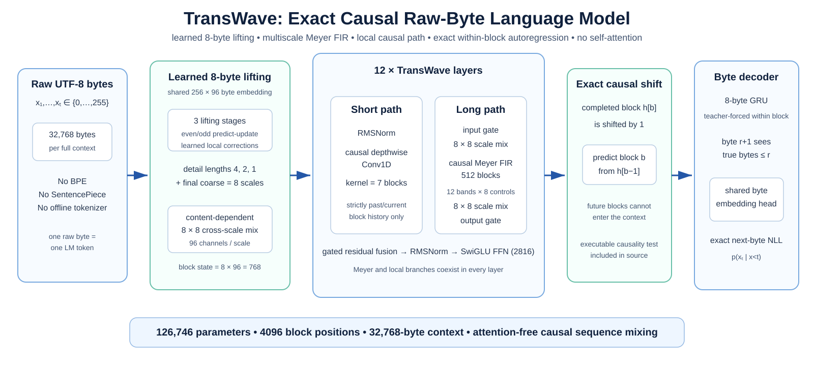
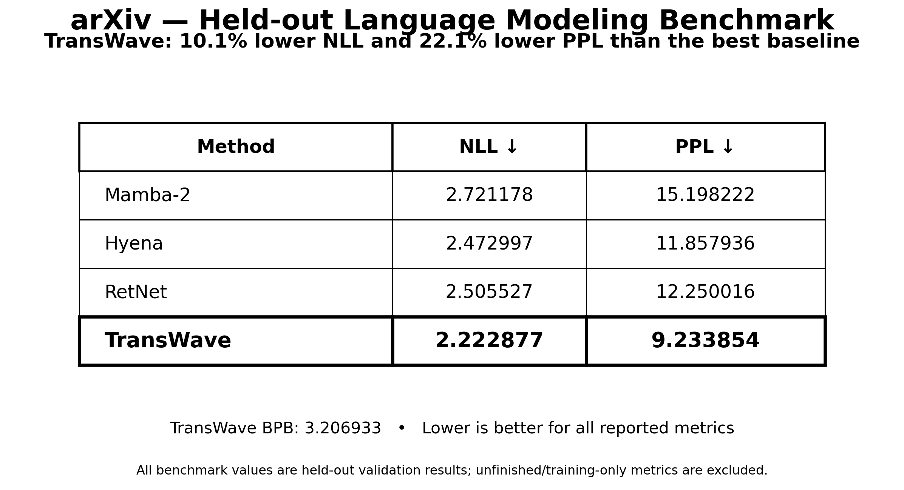
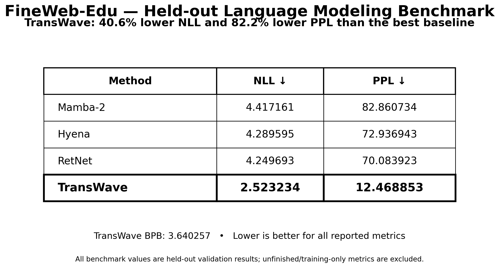
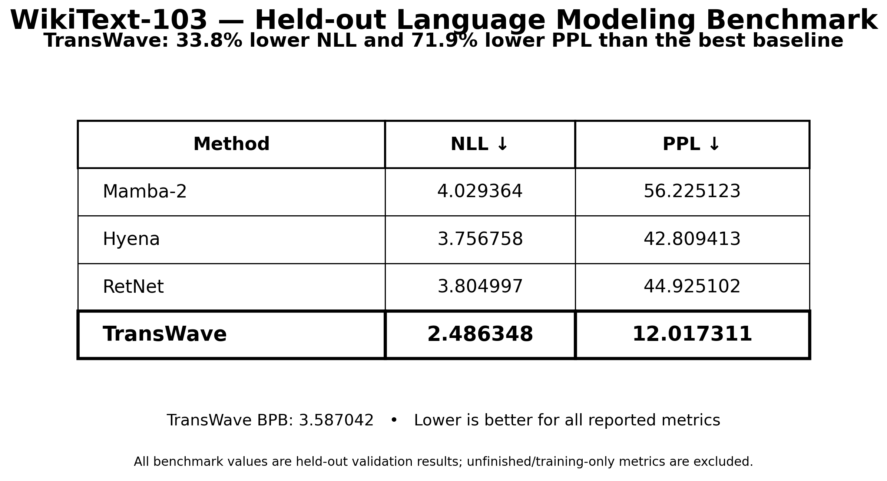

# TransWave

**Causal multiscale Meyer mixing for raw-byte language modeling**

TransWave is a **126,746-parameter, self-attention-free causal language model** that treats long-context sequence modeling as a multiscale signal-processing problem. The frozen released architecture is:

`causal_transwave_blocklifting_meyer_byte_lm_g4_v2`

It consumes **raw UTF-8 bytes directly**, groups them into eight-byte blocks, learns a block-local lifting decomposition into eight scales, mixes information along a short causal path and a long Meyer-structured causal FIR path, shifts completed-block context by one block, and finally predicts the next block **byte by byte** with an autoregressive recurrent decoder.

There is **no BPE, SentencePiece, WordPiece or offline tokenizer**, and there is **no self-attention** in the model.



## What the model is doing

The architecture has four essential steps.

**1. Raw bytes become learned multiscale block states.**  
A full context contains 32,768 raw bytes. The bytes are reshaped into 4,096 non-overlapping blocks of eight. The shared byte embedding has 256 entries of width 96. Inside every block, three learned lifting stages perform even/odd predict-update operations. The resulting detail streams have lengths 4, 2 and 1, followed by one final coarse coefficient. Together they give **8 learned scales x 96 channels = a 768-dimensional block state**.

At each lifting stage, if `e` and `o` denote even and odd positions,

```text
predict(e) = e + Delta_P(e)
detail     = o - predict(e)
coarse     = e + 0.5 * detail + Delta_U(detail)
```

The learned corrections are local grouped neural operators. A content-dependent, group-wise `8 x 8` cross-scale mixer then mixes the eight scale channels at the same block position.

**2. Every layer carries both short and long causal memory.**  
There are 12 TransWave layers. The short path is a strictly causal depthwise convolution with kernel 7 block positions. The long path is

```text
input gate -> 8x8 scale mix -> causal Meyer FIR -> 8x8 scale mix -> output gate
```

The Meyer FIR spans 512 block positions and is parameterized by 12 smooth Meyer-style frequency bands with 8 Bernstein controls per band. The filter coefficients are learned separately by channel group and scale. The long filter is applied as zero-padded linear FFT convolution and cropped to the first `L` outputs, preserving causality. Short and long paths are fused residually and followed by RMSNorm plus a SwiGLU feed-forward network of width 2816.

**3. Completed-block context is shifted before prediction.**  
After the final layer, block `b` is **never** predicted from its own encoded representation. The code explicitly uses

```text
context[b] = h[b-1]
```

with a learned BOS context for the first block. The repository includes an executable future-leakage test in `src/transwave_architecture.py` that changes later blocks and verifies that earlier contexts remain unchanged.

**4. Each eight-byte block is itself decoded autoregressively.**  
A GRU-based byte decoder predicts positions 0 through 7 sequentially. During training, byte `r+1` may condition on the true earlier bytes through position `r`, but never on a future byte. The loss is therefore the exact causal next-byte NLL corresponding to `p(x_t | x_<t)`.

Full implementation details are in [docs/ARCHITECTURE.md](docs/ARCHITECTURE.md).

## Frozen architecture

| Component | Value |
|---|---:|
| Parameters | **126,746** |
| Input vocabulary | 256 raw bytes |
| Raw context | 32,768 bytes |
| Block size | 8 bytes |
| Block context | 4,096 blocks |
| Learned scales | 8 |
| Channels per scale | 96 |
| Block width | 768 |
| TransWave layers | 12 |
| Channel groups | 12 |
| Meyer bands | 12 |
| Controls per Meyer band | 8 |
| Causal Meyer FIR | 512 blocks |
| Local causal kernel | 7 blocks |
| SwiGLU FFN width | 2,816 |
| Decoder hidden width | 256 |

## Final stored causal results

These are the four authoritative held-out TransWave records pulled from Drive and included verbatim under `benchmarks/final_causal_results/`.

| Dataset | NLL ↓ | PPL ↓ | BPB ↓ |
|---|---:|---:|---:|
| arXiv | **2.222877** | **9.233854** | **3.206933** |
| FineWeb-Edu | **2.523234** | **12.468853** | **3.640257** |
| PG19 | **2.452323** | **11.615302** | **3.537955** |
| WikiText-103 | **2.486348** | **12.017311** | **3.587042** |

Each JSON also records `future_leakage: false`, 126,746 trainable parameters, a 32,768-byte raw context and the full validation history.

## Recorded comparison with Mamba-2, Hyena and RetNet

| Dataset | Mamba-2 NLL | Hyena NLL | RetNet NLL | **TransWave NLL** | Mamba-2 PPL | Hyena PPL | RetNet PPL | **TransWave PPL** |
|---|---:|---:|---:|---:|---:|---:|---:|---:|
| arXiv | 2.721178 | 2.472997 | 2.505527 | **2.222877** | 15.198222 | 11.857936 | 12.250016 | **9.233854** |
| FineWeb-Edu | 4.417161 | 4.289595 | 4.249693 | **2.523234** | 82.860734 | 72.936943 | 70.083923 | **12.468853** |
| PG19 | 4.528377 | 4.272470 | 4.298588 | **2.452323** | 92.608091 | 71.698544 | 73.595795 | **11.615302** |
| WikiText-103 | 4.029364 | 3.756758 | 3.804997 | **2.486348** | 56.225123 | 42.809413 | 44.925102 | **12.017311** |

Against the numerically best historical row, the stored TransWave PPL is lower by **22.1% on arXiv, 82.2% on FineWeb-Edu, 83.8% on PG19, and 71.9% on WikiText-103**.

<p align="center">
  
  
</p>
<p align="center">
  
  
</p>

### Important protocol boundary

The numerical separation above is large, but this historical comparison is **not objective-identical**. The Mamba-2, Hyena and RetNet rows came from an earlier **tokenized 15% masked-language-model protocol**, whereas the final TransWave rows are **exact causal raw-byte next-byte likelihood**.

Accordingly, the table is a **recorded numerical reference**, not a controlled causal head-to-head. A definitive architectural comparison requires retraining the baselines under the same raw-byte causal objective, data split, context length, optimization budget and evaluation unit. See [docs/BENCHMARK_PROTOCOL.md](docs/BENCHMARK_PROTOCOL.md).

## Completed 4.5B raw-byte release run

The frozen **TransWave-Meyer-126K-4.5B** run is now complete. It trained on exactly **4,499,996,672 raw-byte tokens**, corresponding to **137,329 complete 32,768-byte contexts**, and finished at step 954.

Its held-out validation is kept separate from the four earlier benchmark records:

| Scope | NLL ↓ | PPL ↓ | BPB ↓ |
|---|---:|---:|---:|
| **Overall** | **2.127545** | **8.394233** | **3.069398** |
| arXiv | 2.029655 | 7.611460 | 2.928173 |
| FineWeb-Edu | 2.189985 | 8.935075 | 3.159480 |
| PG19 | 2.113828 | 8.279874 | 3.049609 |
| WikiText-103 | 2.176712 | 8.817270 | 3.140332 |

The completed run used physical batch 144 for normal steps, fused AdamW, and recorded 72.55 GiB peak allocated / 91.61 GiB peak reserved GPU memory. Total recorded training time was 9,222.19 s.

The release metadata, full training history, batch plan, data manifest and export manifest are under `release/`. The **384.6 MB `model.safetensors`** and **approximately 1.15 GB recovery checkpoint** are deliberately not embedded in this Git source archive.

See [docs/RELEASE_4P5B.md](docs/RELEASE_4P5B.md).

## Repository layout

```text
TransWaveV1/
├── README.md
├── MODEL_CARD.md
├── LICENSE
├── CITATION.cff
├── FILE_MANIFEST.json
├── requirements.txt
├── src/
│   └── transwave_architecture.py
├── training/
│   ├── train_4p5b.py
│   └── TransWave_Meyer_96M_4p5B_HF_Pretrain_G4.ipynb
├── benchmarks/
│   ├── comparison_tables.csv
│   ├── final_causal_results.csv
│   └── final_causal_results/
│       ├── arxiv.json
│       ├── fineweb_edu.json
│       ├── pg19.json
│       └── wikitext103.json
├── figures/
│   ├── architecture/
│   ├── benchmarks/
│   └── conceptual/
├── release/
│   ├── result_4p5b.json
│   ├── training_config_4p5b.json
│   ├── training_history_4p5b.json
│   ├── data_manifest.json
│   ├── g4_batch_plan.json
│   └── export_manifest.json
├── docs/
│   ├── ARCHITECTURE.md
│   ├── BENCHMARK_PROTOCOL.md
│   └── RELEASE_4P5B.md
└── scripts/
    ├── make_benchmark_figures.py
    ├── verify_results.py
    └── check_no_hidden_paths.py
```

There are deliberately **no dot-prefixed files or folders** in this archive: no `.git`, `.github`, `.gitignore`, `.gitattributes`, `.DS_Store`, or similar hidden metadata.

## Installation and checks

```bash
pip install -r requirements.txt
python scripts/verify_results.py
python scripts/check_no_hidden_paths.py
```

To regenerate the benchmark-table figures:

```bash
python scripts/make_benchmark_figures.py
```

## Training

The exact release-scale training program is:

`training/train_4p5b.py`

The frozen Colab/Drive workflow is retained in:

`training/TransWave_Meyer_96M_4p5B_HF_Pretrain_G4.ipynb`

The release program expects the four raw corpora in the Drive hierarchy used by the notebook. It performs full-step GPU memory probing, stages raw text to local storage, uses BF16/TF32, fused AdamW when available, restart-safe checkpointing, periodic atomic Drive persistence, final held-out evaluation and weight export.

Frozen release hyperparameters:

| Setting | Value |
|---|---:|
| Base learning rate | `1e-4` |
| Minimum learning rate | `1e-5` |
| Warmup fraction | `0.01` |
| Adam betas | `(0.9, 0.999)` |
| Adam epsilon | `1e-8` |
| Weight decay | `0` |
| Gradient clip | `1.0` |
| Physical batch | `144` |
| Raw context | `32,768` bytes |
| Target exposure | `4,499,996,672` raw bytes |

## Conceptual symbolic-wavelet figure

The broader TransWave work also explored a **separate symbolic-tensor wavelet design line**. Its infographic is retained here because it captures the symbolic/multiscale design intuition:


**Do not confuse the two implementations.** The four 96M causal JSON records and the completed 4.5B release in this repository use the exact **raw-byte block-lifting architecture** implemented in `src/transwave_architecture.py` and shown in the first architecture figure. The conceptual symbolic-tensor image is not the implementation that produced those four result JSONs.

## Citation

If you use the implementation or results, cite the TransWave work and this repository. A machine-readable citation is provided in `CITATION.cff`.

## License

GNU Affero General Public License v3.0.
